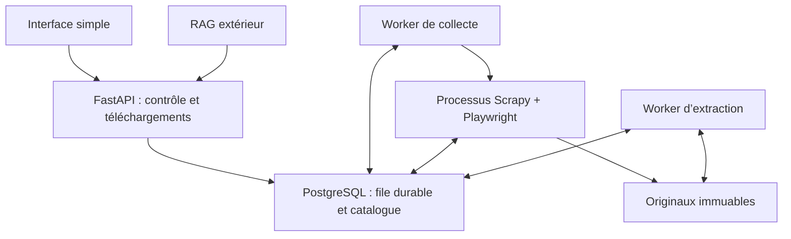
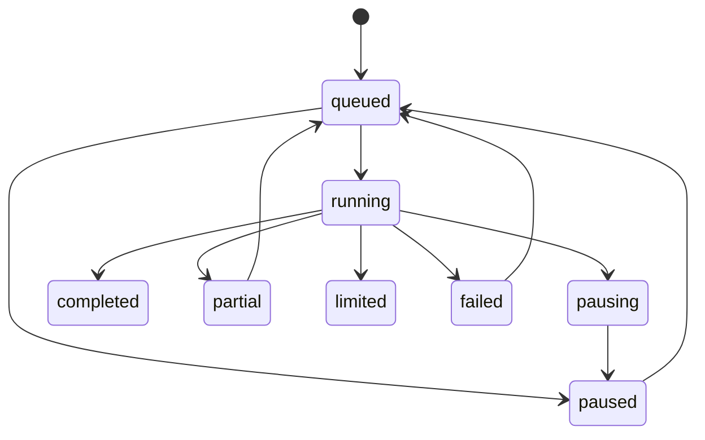

# Architecture du collecteur

Le site est une Source ; une exploration est un Job. Chaque URL du Job est une Task. Un Document désigne une URL de source ; chaque nouveau contenu crée une Version immuable. Les fichiers ne sont pas stockés dans PostgreSQL : la base conserve les chemins et les métadonnées.

Les workers réservent les tâches avec des verrous SQL et une identité de propriétaire. Le parent du crawler renouvelle le heartbeat ; après expiration d'un lease, un autre worker peut reprendre. Chaque écriture de résultat vérifie encore le propriétaire. La file en base sert de point de reprise ; les requêtes HTTP elles-mêmes restent gérées par Scrapy.

Les téléchargements et extractions ont des états indépendants. Un document scanné peut être disponible sans texte ; l'interface indique alors qu'un OCR est nécessaire. L'API fournit un flux d'événements versionnés pour les consommateurs extérieurs.

## États

Une collecte `limited` doit être relancée avec un nouveau budget pour découvrir les liens qui n'ont pas été enregistrés. Pause et reprise concernent les liens déjà persistés. Un nouveau site ajouté depuis l'interface n'interrompt pas le site en cours.

## Frontières

- FastAPI : contrôle et lecture ; aucun navigateur dans le processus API.
- Worker : supervision du processus crawler et heartbeat.
- Scrapy/Playwright : acquisition réseau, sans modèle IA.
- Extraction : transformation des originaux déjà acquis.
- PostgreSQL : vérité des états et références ; migrations futures à prévoir.
- Volume documents : originaux, vues par source et texte JSON.
- RAG : autre projet, autre index, communication par API uniquement.
