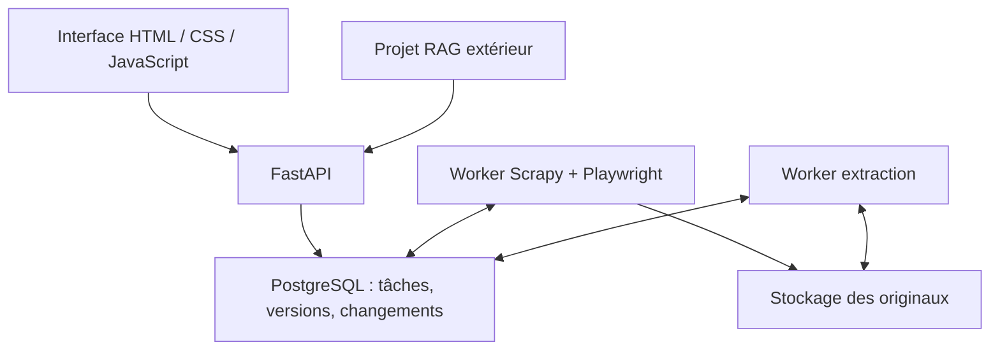

# Collecteur documentaire — FastAPI, Scrapy, Playwright et PostgreSQL

Projet autonome de collecte et d'archivage. Il ne contient aucun modèle RAG ni embeddings. L'API permet à un projet extérieur de synchroniser les documents et leurs textes.

Cette version est un nouveau projet : ne pas la copier dans la base SQLite de l'ancienne application Streamlit. Conserver l'ancien dossier et ses fichiers séparément.

## Démarrage sur Windows avec Docker Desktop

Dans le dossier extrait `collector_pro`, ouvrir un terminal :

```powershell
python scripts/setup.py
docker compose up --build -d
```

Le premier script crée `.env` avec trois secrets aléatoires et refuse de remplacer un fichier existant. Ouvrir `.env`, copier uniquement la valeur `API_KEY`, puis ouvrir :

http://localhost:8000

La clé sert à ouvrir l'interface. Elle n'est pas à publier. PostgreSQL n'est pas exposé sur le réseau hôte ; l'interface est publiée uniquement sur localhost.

Pour suivre les processus :

```powershell
docker compose logs -f worker extractor
```

Pour arrêter sans supprimer les données :

```powershell
docker compose stop
```

Pour relancer :

```powershell
docker compose up -d
```

Ne pas utiliser `docker compose down -v` : cette commande supprime les volumes de données.

## Interface

1. Ajouter l'URL d'un site.
2. Choisir le respect de robots.txt pour cette collecte.
3. Dans Options, garder le budget 1000 pour un premier essai ou mettre 0 pour ne pas imposer de plafond au nombre d'URL.
4. Consulter les collectes, mettre en pause, reprendre et réessayer les erreurs.
5. Filtrer les documents par site, lire le texte, télécharger un original ou l'archive du site.

Ajouter une URL pendant une collecte ne l'interrompt pas : le nouveau site est mis en attente. Un worker traite un site à la fois, avec deux requêtes simultanées au maximum par défaut. Les compteurs distinguent URL découvertes, tâches en attente, ressources en cours, documents et erreurs. Une page HTML n'est pas comptée comme un document PDF.

Les documents téléchargés restent disponibles si leur extraction échoue. Les statuts d'extraction `needs_ocr`, `failed`, `unsupported` ou `empty` restent visibles.

Le budget compte les URL découvertes, y compris les index et les erreurs ; une fois atteint, de nouveaux liens ne sont pas conservés. Pour élargir la couverture après `limited`, créer une nouvelle collecte avec un budget supérieur ou 0. La reprise d'une tâche interrompue / en pause conserve sa file existante.

## Collectes récurrentes et API BoursaMind

À l’ajout d’un site, régler **Répéter toutes les** en minutes. La première
collecte démarre immédiatement. Par exemple, 60 lance un nouveau tour chaque
heure si le worker est disponible, et 1440 correspond à un intervalle de 24 h.
La section **Fréquence par site** permet de modifier l’intervalle ou de l’arrêter
avec 0. Une pause sur une collecte bloque aussi le lancement automatique du
prochain tour pour ce site jusqu’à sa reprise. Si une échéance a été manquée,
le worker lance un seul tour de rattrapage. Le calendrier et la file sont en base.

Le crawler repasse sur les liens accessibles dans son budget et réutilise les
validateurs HTTP quand ils sont disponibles. Une version dont le contenu est
identique n’est pas ajoutée de nouveau. Les originaux et textes extraits
restent dans le volume. PostgreSQL contient les métadonnées, versions et
changements. Les chiffres métier demandent un parseur propre à leur format.

Sur un déploiement existant, conserver les volumes et le fichier `.env`.
Générer une nouvelle valeur aléatoire pour `READER_API_KEY`, puis initialiser la
table de planification et recréer les services avec la configuration mise à jour :

```bash
docker compose build
docker compose run --rm init-db
docker compose up -d
```

Pour un domaine de production, pointer le DNS vers le VPS et terminer HTTPS
au niveau du reverse proxy. Celui-ci doit transmettre les requêtes à l’API
locale sur `127.0.0.1:8000` (ou au port hôte choisi). Garder PostgreSQL hors
exposition publique. Dans `.env`, définir `PUBLIC_ORIGIN=https://collecte.example.com`
avec le vrai domaine, et `COOKIE_SECURE=true`. Configurer le reverse proxy pour
limiter les tentatives sur `/api/login`.

Conserver `API_KEY` pour l’administration. Donner seulement `READER_API_KEY`
au **backend** BoursaMind et transmettre la clé dans `X-API-Key` sur HTTPS.
Cette clé permet la lecture de `/api/documents` et des routes document (métadonnées,
versions, original et texte), ainsi que du flux `/api/changes`. Elle ne donne
aucun accès à l’administration, aux collectes, à la modification des fréquences
ou aux exports par site. Pour la remplacer, générer une nouvelle valeur,
recréer le service API et mettre à jour le secret du backend client.

Le backend BoursaMind peut consommer les événements `document.extracted`
et avancer son curseur seulement après traitement réussi. Pour alimenter
TUNINDEX, utiliser les bulletins BVMT autorisés et le parseur de clôture
BoursaMind. Configurer les droits des sources avant d’activer leur collecte
récurrente en production.

## Architecture



- FastAPI gère les demandes et sert les fichiers ; il ne lance pas un crawler dans le thread d'une requête HTTP.
- Le worker réserve une collecte en base, crée un processus Scrapy séparé et renouvelle son lease.
- La file d'URL est dans PostgreSQL. Scrapy assure le téléchargement ; il n'y a pas de seconde file persistante Scrapy à synchroniser avec celle de la base.
- Le téléchargement HTTP est privilégié. Playwright est utilisé en mode navigateur ou en repli sur 403/406 et HTML très court.
- L'extraction est indépendante. Elle traite les versions en attente sans ralentir directement le téléchargement.
- Le stockage garde les originaux immuables et des noms de fichiers lisibles par source.

## Fichiers et responsabilité

| Fichier | Rôle |
|---|---|
| `app/config.py` | Paramètres d'environnement |
| `app/db.py` | Connexion et transactions SQLAlchemy |
| `app/models.py` | Tables des sources, tâches, documents, versions et changements |
| `app/init_db.py` | Initialisation du schéma neuf |
| `app/urls.py` | URL, périmètre réseau et politique robots commune |
| `app/adapters/__init__.py` | Liens HTML, sitemaps et flux |
| `app/adapters/cmf.py` | Points d'entrée CMF et filtres annuels GET exposés |
| `app/storage.py` | Vérification des fichiers, hash, écritures atomiques et chemins sûrs |
| `app/repository.py` | Réservation, reprise, enregistrement et événements |
| `app/spider.py` | Moteur de collecte Scrapy/Playwright |
| `app/crawl.py` | Point d'entrée du processus crawler |
| `app/worker.py` | Worker de collecte et heartbeat |
| `app/extract.py` | Extraction PDF, DOCX, HTML, texte et option Docling |
| `app/api.py` | API, authentification, contrôles et exports |
| `app/static/` | Interface sans framework frontend ni compilation Node |
| `scripts/setup.py` | Création locale des secrets |
| `tests/` | Tests unitaires, API et collecte HTTP réelle sur fixture |
| `.github/workflows/tests.yml` | CI prévue avec PostgreSQL et Chromium |

`CODE_COMPLET.md` est un instantané de la première version. Les fichiers du dépôt font autorité pour le code actuel.

## Données et téléchargements

Dans le volume Docker `documents` :

- `/storage/blobs/` : originaux identifiés par SHA-256.
- `/storage/sources/<source_id>/documents/` : documents avec nom lisible et suffixe de hash.
- `/storage/sources/<source_id>/pages/` : originaux HTML.
- `/storage/text/<version_id>.json` : texte, pages ou structure Docling.

Le téléchargement d'un ZIP ne charge pas toute l'archive en RAM côté serveur : elle est préparée dans un fichier temporaire et servie par `FileResponse`, puis supprimée. La construction du ZIP est synchrone et peut être longue sur une grande source ; plusieurs exports simultanés nécessitent assez d'espace temporaire.

Une archive contient les originaux des versions archivées, les textes disponibles, un catalogue courant et le journal des erreurs. Sur PostgreSQL, l'export utilise un instantané transactionnel cohérent. Les mêmes octets ne sont pas dupliqués dans le stockage central ; des liens physiques sont utilisés pour la vue par source lorsque le système le permet.

Pour copier tout le stockage sur le PC sans passer par un ZIP navigateur :

```powershell
docker compose cp api:/storage ./storage_backup
```

Pour une sauvegarde cohérente fichiers + base, arrêter d'abord le worker et l'extracteur, sauvegarder le volume, puis exporter PostgreSQL avec `pg_dump`. Ne pas publier `.env`.

## Fiabilité

- Les PDF sont contrôlés par leur signature et le lecteur PDF ; une page HTML à une URL `.pdf` est un échec.
- Un PDF chiffré valide est conservé mais son extraction peut échouer sans mot de passe.
- Les DOCX/XLSX/PPTX/ODT sont vérifiés comme conteneurs Office/ODF ; les anciens formats Office ont une vérification de signature.
- Les écritures passent par un fichier temporaire, `fsync`, puis un remplacement atomique.
- Les erreurs transitoires ont au maximum trois tentatives, avec attente progressive.
- Les index facultatifs absents ne sont pas présentés comme des documents téléchargés.
- Une URL réussie n'est pas revisitée lors de la reprise du même job ; une nouvelle collecte revalide les données.
- Les validateurs HTTP ETag / Last-Modified sont utilisés quand le serveur les fournit.
- Un worker dont le lease a été remplacé ne peut plus enregistrer de résultat en base.
- Une version déjà enregistrée ne génère pas de nouvel événement de contenu identique.
- Le curseur de changements est alloué dans une transaction sérialisée sur une horloge SQL ; le RAG consomme les événements dans cet ordre.

Le délai de reprise après disparition d'un worker est `LEASE_SECONDS`, 180 secondes par défaut. Un arrêt normal demande une pause et attend la ressource en cours. Les tâches d'extraction restées `processing` sont réessayées après une heure ; lancer un seul extracteur pour cette version.

Les blobs écrits juste avant une perte de lease peuvent rester orphelins sur disque ; aucun nettoyage destructif automatique n'est effectué. La base reste la référence des documents archivés.

## robots.txt et accès réseau

La case reste un choix par collecte. Sa valeur est copiée dans la politique du job et ne change pas rétroactivement quand une autre collecte est ajoutée.

- Activée : règles appliquées aux requêtes HTTP et aux navigations navigateur. Si robots.txt ne peut pas être vérifié, la ressource est signalée en échec ; 404/410 signifient absence de règles.
- Désactivée : robots.txt n'est pas demandé pour prendre la décision de collecte.

Les URL locales, privées, identifiants dans les URL et ports non standards sont refusés. Les autres hôtes doivent être autorisés explicitement. Les ressources externes nécessaires au rendu ne peuvent cibler que des adresses publiques.

Ce filtrage applicatif ne remplace pas une isolation réseau contre le DNS rebinding. Pour déployer au-delà de localhost, ajouter TLS, filtrage sortant et limitation des connexions / tentatives de connexion. Le code ne désactive pas TLS et ne contient ni mode furtif, ni rotation de proxy, ni résolution de CAPTCHA. Un 403 persistant est visible ; la case robots ne supprime pas ce refus.

## Extraction

Le mode par défaut `EXTRACTOR=basic` :

- PDF : texte page par page ; une page sans texte place le résultat en `needs_ocr`, tout en conservant les pages lisibles.
- DOCX : paragraphes et tableaux, sans inventer de numéros de page.
- HTML : texte principal nettoyé.
- TXT / CSV / RTF : décodage UTF-8 ; RTF conservé textuellement, sans moteur de mise en page.
- Autres formats : original disponible, extraction `unsupported`.

Pour activer l'intégration Docling, définir dans `.env` :

```dotenv
INSTALL_DOCLING=true
EXTRACTOR=docling
```

Puis reconstruire l'image. Docling peut télécharger ses modèles au premier traitement. Cette intégration convertit PDF/DOCX/XLSX/PPTX/HTML en Markdown et JSON structuré. L'OCR et les langues dépendent des moteurs et modèles installés ; ce n'est pas une garantie de qualité sur les tableaux ou l'arabe. Tester un échantillon réel avant d'en dépendre. L'intégration Docling n'a pas été exécutée dans l'environnement de livraison.

## API pour un futur RAG

Authentification : en-tête `X-API-Key`, ou cookie HttpOnly pour l'interface locale. La clé est une clé de ce collecteur, pas une clé de modèle IA. L'interface utilise uniquement du JavaScript local ; pas de CORS ouvert.

| Méthode et chemin | Utilité |
|---|---|
| `POST /api/sources` | Ajouter / relancer un site |
| `GET /api/jobs` | États et compteurs |
| `POST /api/jobs/{id}/pause` | Demander une pause |
| `POST /api/jobs/{id}/resume` | Reprendre la file |
| `POST /api/jobs/{id}/retry` | Reprendre en réessayant les erreurs |
| `GET /api/jobs/{id}/errors` | Erreurs paginées |
| `GET /api/documents` | Liste paginée et filtrée |
| `GET /api/documents/{id}` | Métadonnées courantes |
| `GET /api/documents/{id}/file` | Original, version courante ou `?version_id=...` |
| `GET /api/documents/{id}/text` | Texte et références, également versionnable |
| `GET /api/documents/{id}/versions` | Historique des versions |
| `GET /api/changes?cursor=0` | Événements incrémentaux |
| `GET /api/sources/{id}/export` | ZIP du site |

Les événements `document.updated` et `document.extracted` sont distincts. Le RAG ne doit pas interpréter l'arrivée d'un original comme l'arrivée d'un texte prêt. Il peut utiliser `version_id` pour lire exactement la version annoncée. Aucun endpoint de suppression n'est inclus dans cette version ; le flux ne prétend pas détecter les suppressions distantes.

Exemple Python extérieur :

```python
import os
import requests

headers = {"X-API-Key": os.environ["COLLECTOR_API_KEY"]}
base = "http://localhost:8000"
feed = requests.get(base + "/api/changes", headers=headers,
                    params={"cursor": 0}, timeout=30).json()
for event in feed["items"]:
    if event["event"] == "document.extracted":
        response = requests.get(
            base + f"/api/documents/{event['document_id']}/text",
            headers=headers, params={"version_id": event["version_id"]}, timeout=30
        )
        response.raise_for_status()
        payload = response.json()
        if payload["status"] == "done":
            print(payload["text"][:200])
# Persister next_cursor seulement après traitement réussi des événements.
```

## Tests et limites de validation

```powershell
python -m pip install -r requirements-dev.txt
python -m pytest -q
```

Le test HTTP lance un vrai serveur local de fixture et un vrai processus Scrapy. Il vérifie pagination, téléchargement PDF/DOCX, rejet d'un faux PDF, archivage SQL, extraction et restitution via API. L'autorisation du loopback et du port de fixture n'existe que dans `tests/` ; elle n'est pas activée dans l'application.

Le test navigateur est inclus et s'exécute si Chromium est installé ; sinon il est explicitement ignoré. La CI fournie configure PostgreSQL et Chromium mais n'a pas été lancée depuis cette livraison.

Résultat dans l'environnement de création : 21 tests réussis, 1 test navigateur ignoré. Syntaxe JavaScript et code Python vérifiés. Base de test SQLite. Docker et PostgreSQL n'étant pas disponibles, aucun démarrage Docker ni test transactionnel réel PostgreSQL n'est revendiqué. Le téléchargement de Chromium a échoué dans cet environnement. Aucune collecte réelle complète CMF n'est certifiée.

Le schéma est initialisé pour ce nouveau projet. Les futures évolutions de schéma nécessiteront une migration versionnée avant mise à jour d'une base existante. Les dépendances directes principales sont épinglées aux versions installées ; Docling est optionnel et non épinglé à une version testée.

## Couverture réelle

L'adaptateur CMF fournit ses points d'entrée connus, les liens de pagination et les filtres annuels GET exposés dans le HTML. Les rubriques trouvées dans le plan du site sont parcourues. Les formulaires POST, boutons spécifiques sans URL, documents non liés et contenus protégés demandent un adaptateur supplémentaire et des essais réels. La date de collecte n'est pas présentée comme la date de publication ; société, période et date de publication ne sont pas inférées automatiquement.

Un crawler sans plafond peut suivre des variantes d'URL en très grand nombre. Le budget et la pause restent disponibles. « File épuisée » signifie tous les liens de cette exploration traités, pas tous les documents existants du site.
